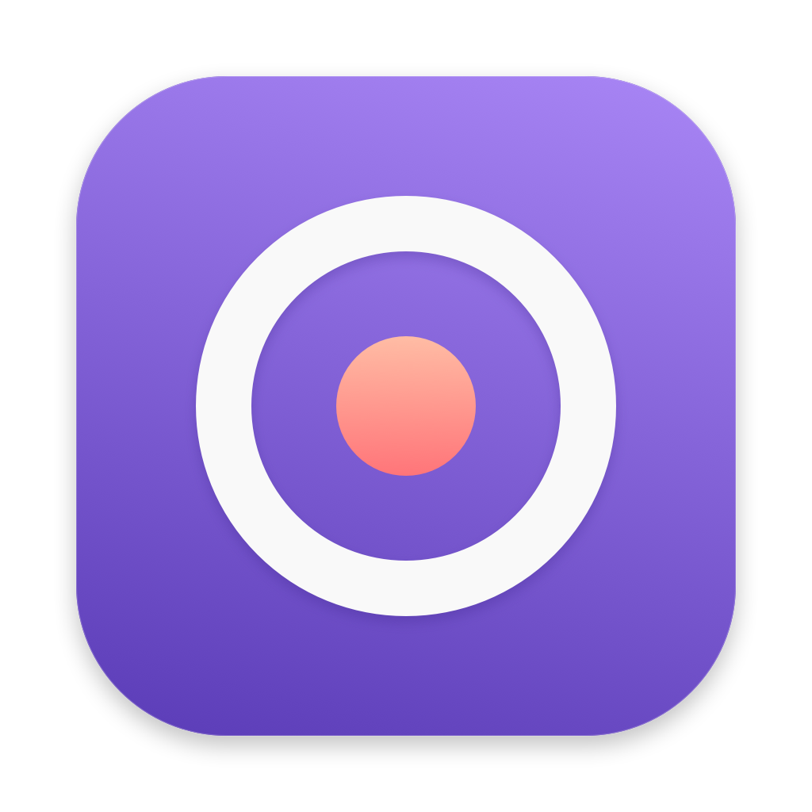
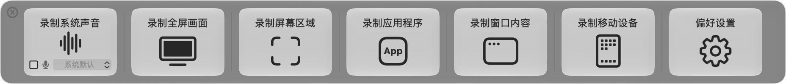
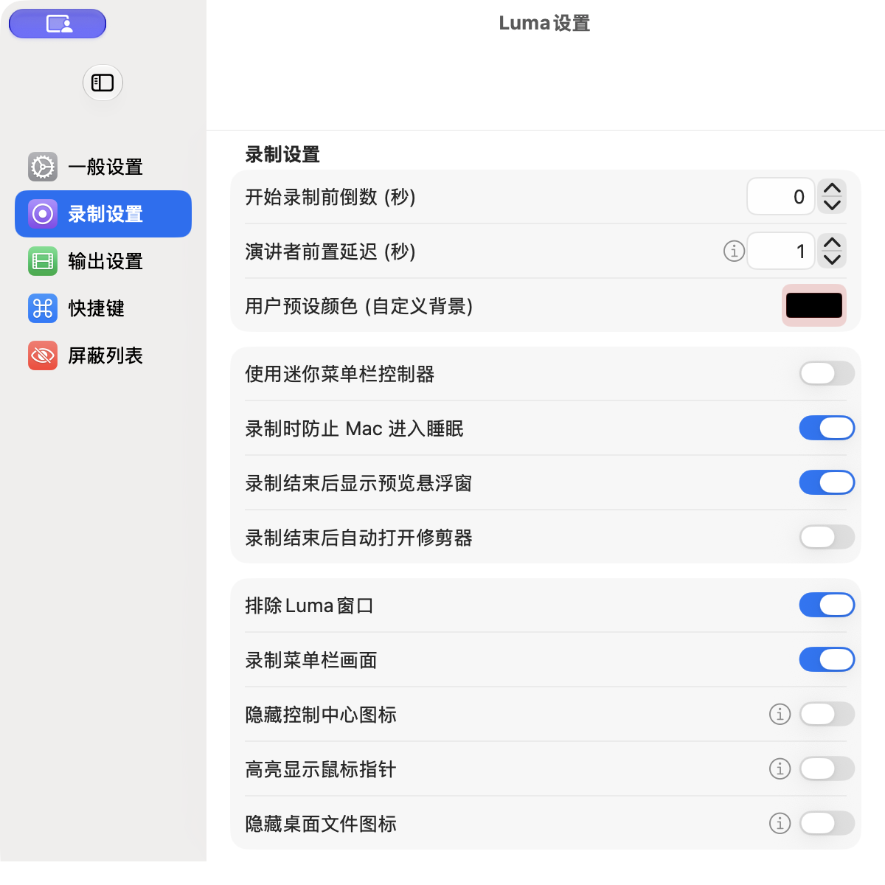
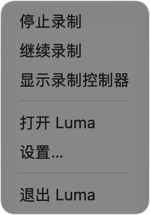

<p align="center">
  
</p>
<h1 align="center">Luma</h1>
<p align="center">A simple, native screen recorder for macOS.</p>
<p align="center"><a href="README_zh.md">简体中文</a> · <a href="https://github.com/liudicy/Luma/releases">Releases</a> · <a href="https://github.com/liudicy/Luma/issues">Report an issue</a></p>

Record a screen, a window, an application or just the area you need. Luma brings recording sources into one small panel, with system audio, an optional microphone and controls in the menu bar.

## A small panel. Everything you need.

<p align="center"></p>

- **Choose your source:** display, area, window, application, system audio or supported mobile device.
- **Capture sound:** system audio without a virtual audio driver, optional microphone input and separate audio tracks.
- **Stay in control:** native menu bar pause/resume/stop, a floating controller, keyboard shortcuts and timed recording.
- **Make it yours:** H.264 or HEVC, quality and frame-rate settings, camera overlays, mouse highlighting and magnification.
- **Finish quickly:** recording preview, video trimming and a configurable output folder.
- **Feel at home:** Liquid Glass on macOS 26+, with material backgrounds on earlier versions.

## Inside Luma

| Recording options | Recording controls |
| :---: | :---: |
|  |  |

Actual screenshots from Luma 1.7.1 on macOS 27.0.1, using the Chinese interface.

This version repairs permission handling, replaces hover-dependent menu bar controls with a native menu, corrects pause timing across audio and video, and waits for recording files to finish saving. The H.265 onboarding tip remembers your choice. See [verification notes](docs/verification.md) for the configurations tested and the remaining acceptance checks.

## Start recording

1. Open **Luma** and choose a source.
2. Allow **Screen & System Audio Recording** in System Settings when requested. Microphone and camera access are needed only when you use those features.
3. Choose the target and start. Click the recording icon and timer in the menu bar to pause, resume or stop. Choose **Show Recording Controls** for a floating controller.
4. Find the file in your chosen output folder. The default is Desktop.

### Installation

The current source version is **1.7.1**. Packaged downloads, when available, are listed under [Releases](https://github.com/liudicy/Luma/releases). Check the release name and notes: older QuickRecorder packages do not contain this Luma version. You can also build the signed app from source below.

The minimum deployment target is **macOS 12.3**. System audio requires macOS 13+, Presenter Overlay requires macOS 14+, and Liquid Glass requires macOS 26+. Build with **Xcode 26 or later**. Older systems, Intel hardware and external recording devices need additional runtime coverage; the deployment target alone is not a compatibility guarantee.

### Screen permission is enabled, but capture is denied

Use one installed copy in a stable location, preferably `/Applications/Luma.app`. Enable Luma under **System Settings → Privacy & Security → Screen & System Audio Recording**, then quit and reopen the app if macOS requires it.

Local builds should use a consistent Apple signing identity. Switching between signed and unsigned copies can invalidate the stored authorization while leaving its settings toggle enabled. Luma does not automatically retry a denied request or force-quit after denial.

## Build from source

```sh
git clone https://github.com/liudicy/Luma.git
cd Luma
./Scripts/build_and_check_signing.sh
open build/signed-DerivedData/Build/Products/Release/Luma.app
```

The helper finds a usable Apple signing certificate in your keychain and builds a signed Release app. In Xcode, select your own team under **Signing & Capabilities**. It does not create certificates or notarize a distribution build. `--reset-tcc` explicitly resets screen permission; `--prove` runs an interactive rebuild check.

The Xcode project/target remain `QuickRecorder`, and the bundle ID remains `com.liudicy.QuickRecorder` to preserve this fork's settings and authorization identity. The app's product name is **Luma**. Swift Package Manager resolves the pinned dependencies in `Package.resolved`.

```sh
# Run the pause/audio-video timeline regression checks.
./Scripts/test_recording_timeline.sh
# Regenerate every app-icon size from the vector drawing source.
swift Scripts/generate_icon.swift
```

## Contribute

[Open an issue](https://github.com/liudicy/Luma/issues) with the app/macOS versions, installation or signing method, recording mode, audio settings and steps to reproduce. Note whether the issue follows pause/resume or a permission change. Please keep private screen content out of reports.

## Open-source notice

Luma is an independently maintained fork of [QuickRecorder](https://github.com/lihaoyun6/QuickRecorder) by [lihaoyun6](https://github.com/lihaoyun6) and its contributors. It continues under **GNU AGPL version 3**. The original [LICENSE](LICENSE) and source copyright notices are preserved; Luma's modifications and new icon use the same license.

[NOTICE](NOTICE) records the project provenance, including Azayaka-derived recording code. [THIRD_PARTY_NOTICES.txt](THIRD_PARTY_NOTICES.txt) contains dependency licenses and copyright notices. All three files are included in the app bundle. This project is maintained at [liudicy/Luma](https://github.com/liudicy/Luma).
